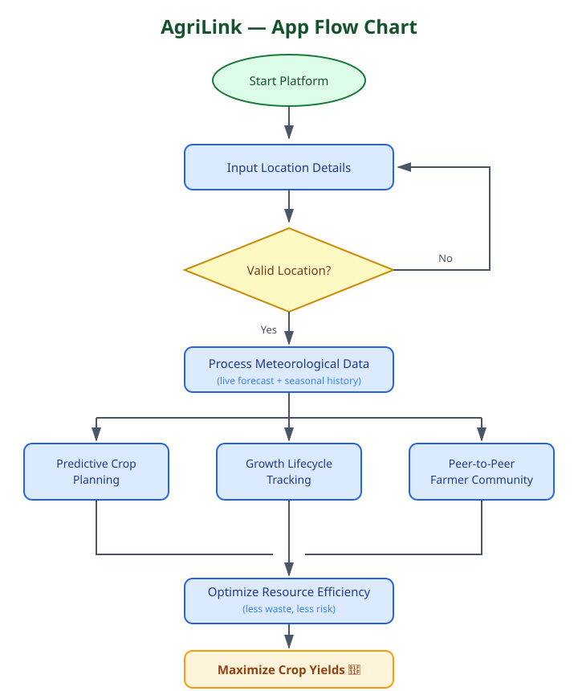

# AgriLink — Backend

The Python server (FastAPI) behind **AgriLink**, a planting-almanac app that helps Caribbean farmers decide **when to plant**. It serves the app and provides the API the frontend calls: live weather, ten years of climate history, a crop database and a planting recommendation engine.

The app itself is deployed at **https://timely-marshmallow-9054ac.netlify.app** — this repo holds only the backend code.

## Run it

```bash
pip install -r backend/requirements.txt
uvicorn backend.main:app --reload
```

Then open `http://localhost:8000`. If the frontend files are placed next to the `backend/` folder, the same command serves the whole app; interactive API docs are always at `http://localhost:8000/docs`.

## API

| Endpoint | Returns |
|---|---|
| `GET /api/parishes` | all 126 regions across 14 countries, grouped by country, with coordinates |
| `GET /api/farm-data/{country}/{region}` | live 7-day forecast and ten-year climate history (e.g. `/api/farm-data/Jamaica/Clarendon`) |
| `GET /api/crops` | crop database with planting windows and growth stages |
| `GET /api/recommend/{country}/{region}?crop=Corn` | scored planting recommendation |
| `GET /api/problems` | crop-problem dataset used by the photo checker |

The old one-name routes (`/api/farm-data/{parish}`, `/api/recommend/{parish}`) still work for Jamaica parishes.

Other features:

- **Rate limiting** — per-IP sliding window on the weather endpoints (they trigger ~11 upstream calls each), with `X-RateLimit-*` headers and `429` responses.
- **Caching** — farm data is cached for 10 minutes per region.
- **Static hosting** — the server mounts the parent directory, so it can serve the frontend in one command.

## Countries and regions covered

**126 regions across 14 Caribbean countries**, defined in `backend/main.py` (`LOCATIONS`):

| Country | Regions |
|---|---|
| Jamaica | 14 parishes |
| Barbados | 11 parishes |
| St. Kitts & Nevis | 13 parishes (St. Kitts + Nevis) |
| Dominican Republic | 11 regions |
| Haiti | 10 departments |
| St. Lucia | 10 districts |
| Dominica | 10 parishes |
| Trinidad & Tobago | 9 areas incl. Tobago |
| Guyana | 7 regions |
| Antigua & Barbuda | 6 parishes + Barbuda |
| Belize | 6 districts |
| Bahamas | 6 islands |
| Grenada | 6 parishes |
| St. Vincent & the Grenadines | 6 parishes + the Grenadines |

Region names repeat across countries (several have a "Saint George"), so the API always keeps the country with the region — every response includes both, and the frontend labels locations "Town, Region, Country".

## App flow

How a farmer moves through the app, from first launch to the community board:



## How the planting score works

1. **Season** — is this one of the crop's best months?
2. **Climate history** — the 10-year average rainfall for this month in the farmer's area.
3. **Live forecast** — rain and temperature for the next 7 days.

Each signal shows as a plus or minus, so the score is easy to read.

Data comes from [Open-Meteo](https://open-meteo.com) (free, no key needed).

## Built with

Python only (FastAPI + httpx). No frameworks, no build step.
